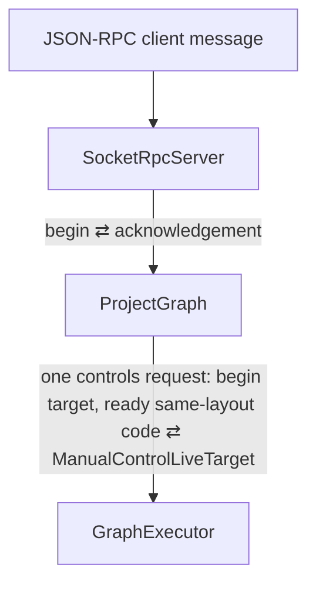
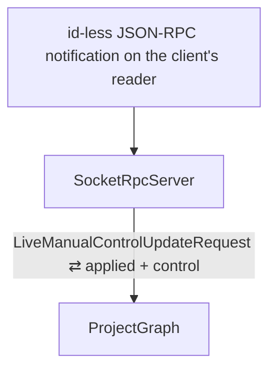
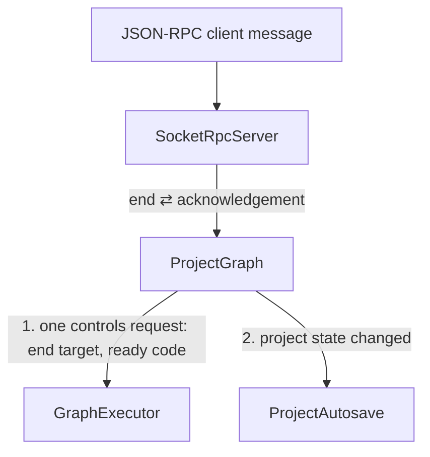
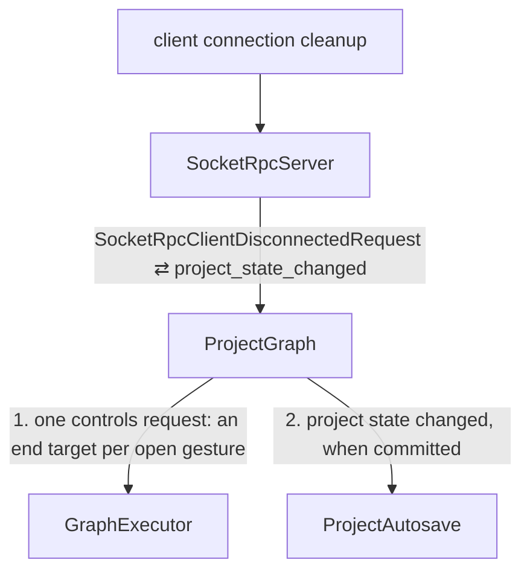
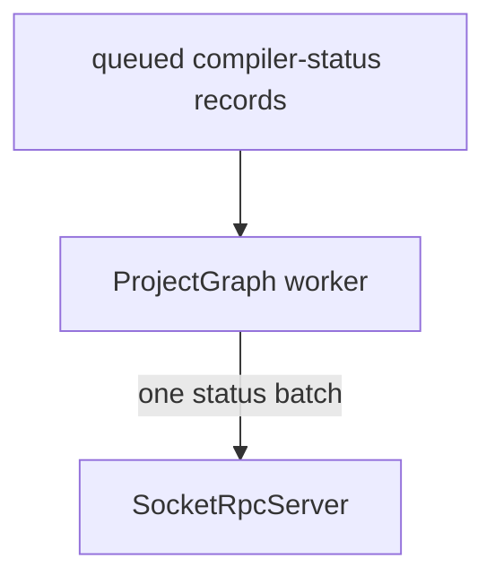

# Event Flow: Manual-Control Gesture

This procedure covers one knob gesture: `manualControls.begin`, its live
updates, and `manualControls.end` or the client's disconnect. The contract is
[Live gesture values are transient](../node_presentation_and_manual_controls_direction.md#live-gesture-values-are-transient).
_Implementation status (2026-11-14): the owner reports passing tests. The
subsequent cleanup is awaiting owner verification._

## Begin

The begin changes no durable record. `SocketRpcServer` assigns it one session
revision after the response, so other views re-read the scope and see the gesture
open. Any dynamic-code compilation it schedules completes later as its own cause.

## Live update

`ProjectGraph` takes only its live-gesture lock and stores the value into the
`ManualControlLiveTarget` it received at begin. That cell is shared state handed
over on the begin edge, like the target scalar of a dynamic input. Storing into it
is not an event, so `GraphExecutor` is not entered. The audio thread copies the
cell into the active `NodeStorage` before each root call. `SocketRpcServer` then
relays the applied value to the other clients as a replaceable frame. There is no
revision and no reply.

## End

`ProjectGraph` commits the value and the gesture's one history entry before the
controls request. `GraphExecutor` writes the value into every accepted generation
that binds the control, then closes the live target. `SocketRpcServer` discards
the gesture's unwritten relay frames before publishing the end's revision.

If that client still hovers the released knob, end also schedules a predictive
GraphJit request for the variant needed when it leaves. The candidate uses the
committed value while preserving other clients' required dynamic controls. It
does not activate on completion. Hover leave consumes the matching ready
candidate, or promotes the matching queued/running request to allow staging.
A second release with a changed constant supersedes the older candidate.

If the candidate changes storage, leave reuses its steady compilation and then
uses the existing predecessor-aware graph-transition compilation. Release does
not pre-stage a structural successor. This is the same boundary used by dynamic
hover preparation.

## Toggle an input knob

Each click sends `manualControls.toggleInput` with the knob's address and input
name. The server orders it with other edits. `ProjectGraph` reads the latest
enabled state under its lock and flips it while preserving the stored value and
participation. The gesture end commits its value against that same durable
record, so it preserves a toggle that reaches the server before release. The
client can send another click before receiving the previous revision.

## Disconnect

Each of the client's open gestures ends at the last value received from it, in
one controls request. `SocketRpcServer` discards the client's unwritten relay
frames, then publishes one revision when the record reports a commit.

## Compilation progress notifications

Implementation checkpoint (2026-11-14; new logging awaits owner verification):
`ProjectGraph` queues `ProjectControlCompileStatus` records while holding its own
lock. Incoming hover/begin/end causes do not call `SocketRpcServer` to publish
these records. The control-compile worker drains the records after releasing the
lock and opens a separate `control compilation status` source:

`SocketRpcServer::handle_control_compile_status()` publishes the records on
`graph.controlCompilation`. These notifications change no project record or
session revision. They describe queued, compiling, prepared, staged, superseded
and failed jobs; storage-changing jobs also report `compilingStorage`.

A request id identifies the job across phases. Times begin in
`ProjectGraph::schedule_control_compile_locked()`, before it copies the configured
graph. `queueUs` includes that request preparation and the wait until the worker
starts. `preparationUs` ends when GraphJit returns usable candidate code.
`stageUs` measures the executor request that accepts it. `elapsedUs` is the job's
wall-clock age at the reported phase. Predictive hover or release can prepare code long
before a gesture or hover leave requests staging, so job age can include that deliberate wait.
Storage-changing jobs prepare a final successor before reporting staging.

None of these times measures RPC transit or the audio callback's later activation.
Those endpoints need separate observations; clients must not label staging as
activation or audible latency. Failures keep the previous executable and report
the available GraphJit diagnostic. Superseded queued/in-flight jobs receive a
terminal status so client pending counts can clear.

The extension logs every phase and shows queued/running job counts in a separate
status-bar item. Prepared/staged completion remains visible briefly, and a failure
remains visible until another status or disconnect. It does not re-read graph
scopes or add traffic for live `manualControls.update` messages.
