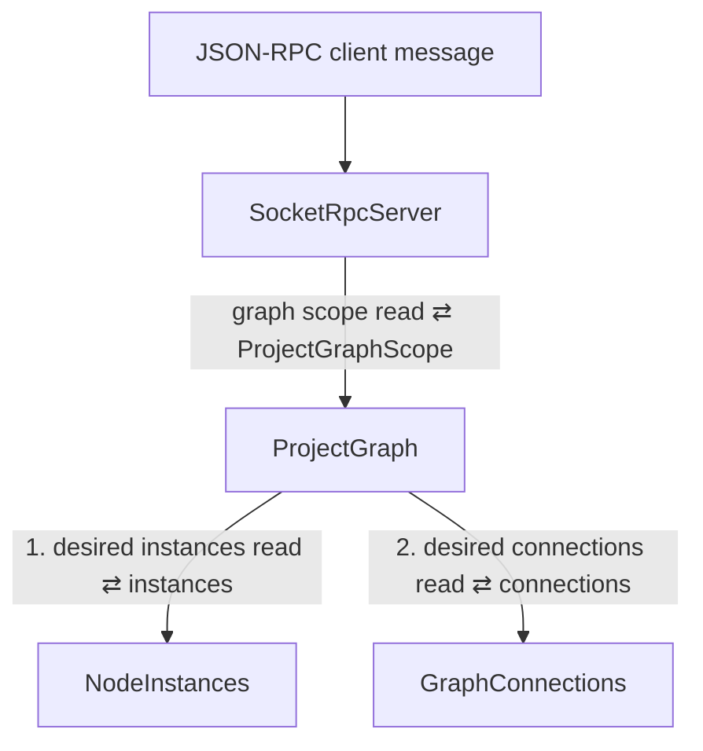

# Event Flow: Graph Scope Read

This procedure covers one `graph.getScope` client message: the graph editor's
read of the project root scope. The editor is specified in
[The graph editor is opened on one node](../node_presentation_and_manual_controls_direction.md#the-graph-editor-is-opened-on-one-node).

## Propagation tree

`ProjectGraph` holds its lock across both reads. Every project mutation holds
the same lock while it changes `NodeInstances` and `GraphConnections`, so one
read describes one revision.

`ProjectGraph` adds to the desired state what only it holds: the current
generation. Each instance placed in that generation gets the ports of its root
bundle, read through the same port tables `GraphConnections` resolves a
`ProjectPortMatcher` against, so a port's index is the one a connection uses.
Each desired connection is marked applied when the generation applied it, so a
connection whose endpoint is missing stays visible.

## Change notification

Every root build sets `graph_changed` on its `ProjectGraphPublication`, which
returns to the cause's root with the build's other read-model changes (see
[README](./README.md)). `SocketRpcServer` publishes it as one `graph.changed`
notification, and each editor re-reads its scope.
