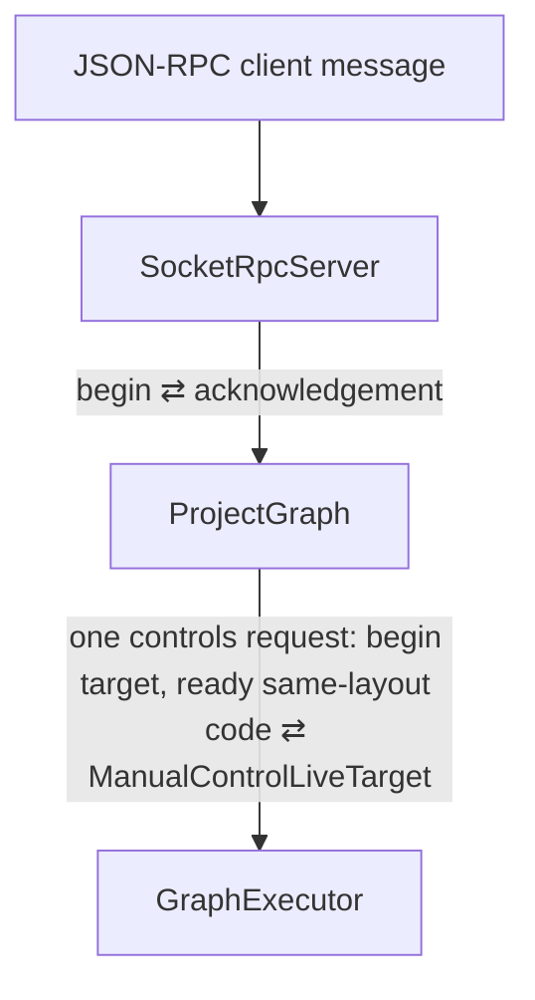
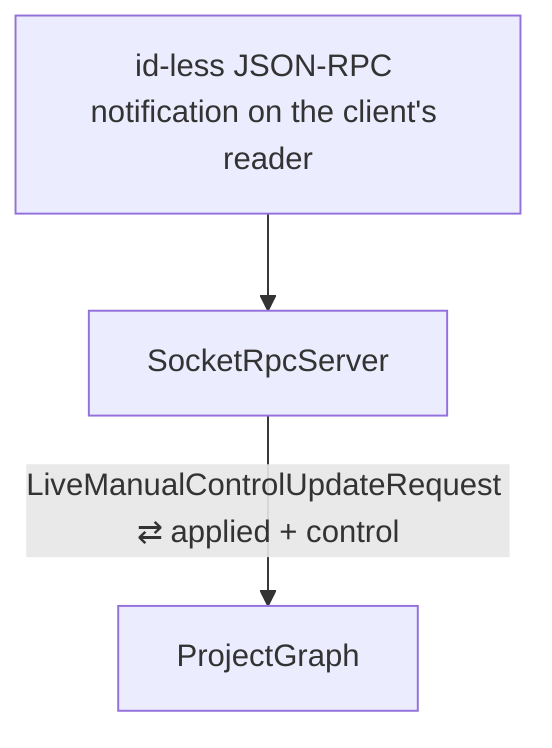
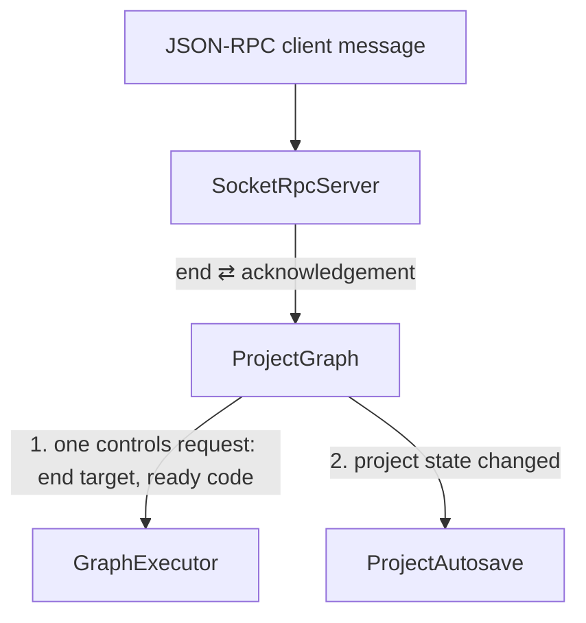
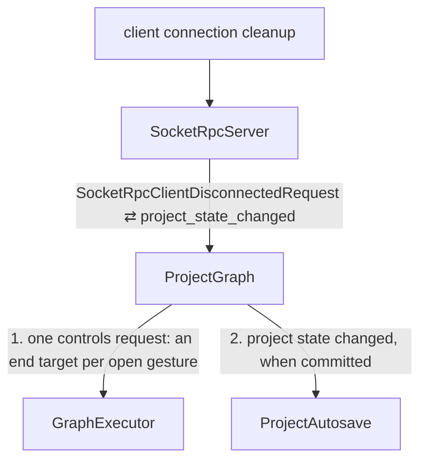

# Event Flow: Manual-Control Gesture

This procedure covers one knob gesture: `manualControls.begin`, its live
updates, and `manualControls.end` or the client's disconnect. The contract is
[Live gesture values are transient](../node_presentation_and_manual_controls_direction.md#live-gesture-values-are-transient).
_Implementation status (2026-11-14): the owner reports passing tests. The
subsequent cleanup is awaiting owner verification._

## Begin

The begin changes no durable record. `SocketRpcServer` assigns it one session
revision after the response, so other views re-read the scope and see the gesture
open. Any dynamic-code compilation it schedules completes later as its own cause.

## Live update

`ProjectGraph` takes only its live-gesture lock and stores the value into the
`ManualControlLiveTarget` it received at begin. That cell is shared state handed
over on the begin edge, like the target scalar of a dynamic input. Storing into it
is not an event, so `GraphExecutor` is not entered. The audio thread copies the
cell into the active `NodeStorage` before each root call. `SocketRpcServer` then
relays the applied value to the other clients as a replaceable frame. There is no
revision and no reply.

## End

`ProjectGraph` commits the value and the gesture's one history entry before the
controls request. `GraphExecutor` writes the value into every accepted generation
that binds the control, then closes the live target. `SocketRpcServer` discards
the gesture's unwritten relay frames before publishing the end's revision.

## Disconnect

Each of the client's open gestures ends at the last value received from it, in
one controls request. `SocketRpcServer` discards the client's unwritten relay
frames, then publishes one revision when the record reports a commit.
