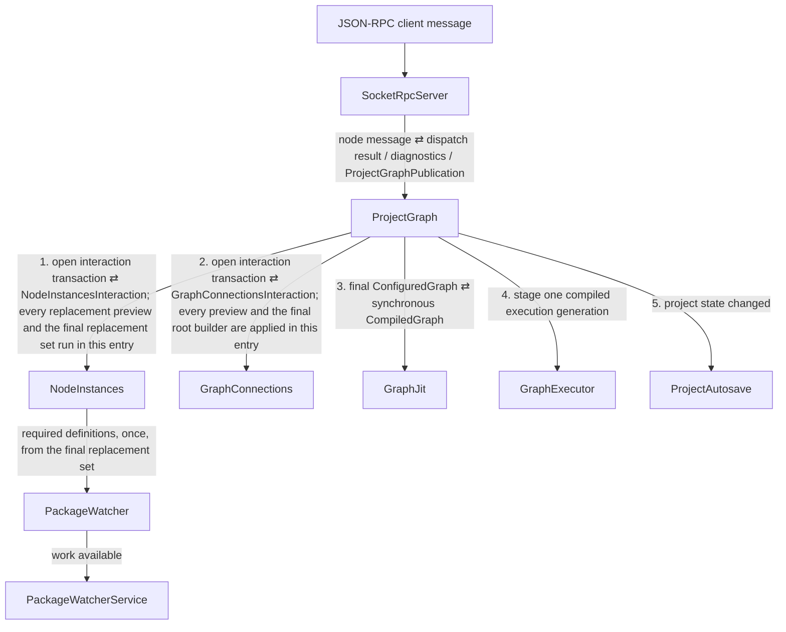

# Event Flow: Node Message Interaction

This procedure covers one `nodeMessages.dispatch` client message: a typed node
message delivered to a semantic node, whose handlers may send further messages
and replace nodes. The interaction semantics are defined in
[../node_interaction_and_presentation_communication_direction.md](../node_interaction_and_presentation_communication_direction.md).

## Propagation tree

The tree applies when a handler replaces a node. A message whose handlers only
send further messages reaches no other module. The interaction then commits
nothing, and the tree is `SocketRpcServer -> ProjectGraph`.

## Why the interaction is a transaction

After `ctx.replace(...)`, later operations of the same interaction address the
successor semantic world. `ProjectGraph` must therefore configure a preview
graph after each replacement, before delivering the next message. One
interaction can configure several previews before it commits.

Those configurations are steps of one computation, not separate propagations.
`ProjectGraph` enters `NodeInstances` and `GraphConnections` once each, through
`iv_runtime_project_graph_node_instances_interaction_requested_event` and
`iv_runtime_project_graph_connections_interaction_requested_event`, when the
first replacement is previewed. Each opening returns a transaction
(`NodeInstancesInteraction`, `GraphConnectionsInteraction`); every later preview
and the final replacement set run through it as part of that one entry. See
[Module transactions](../event_propagation_tree_constraint.md#module-transactions).

- A preview (`NodeReplacementPreviewMutation`) changes no desired state and
  raises nothing.
- The final replacement set (`NodeReplacementsReplaceMutation`) is committed
  once. It is the only run that can raise `NodeInstances`' required-definitions
  change, so `PackageWatcher` is reached once.
- `GraphConnectionsInteraction` never changes desired connections. It applies
  the unchanged connection set to each preview and final root builder.
- Only the final build compiles and stages: previews skip `GraphJit` and
  `GraphExecutor`.

A failed preview or a rejected second delivery to one node fails the whole
interaction. Nothing has been committed, so desired state is unchanged.
