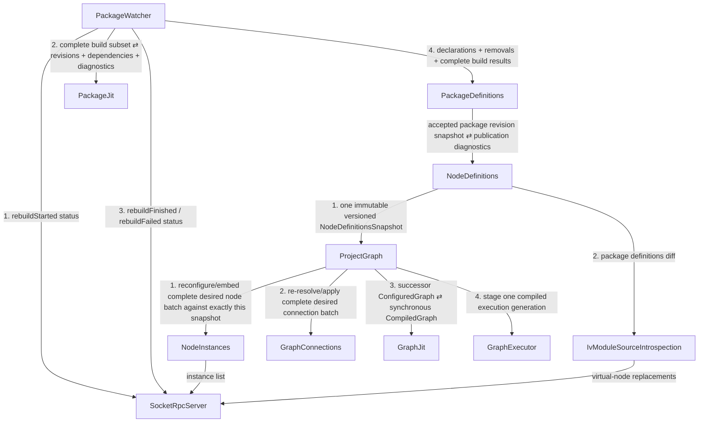
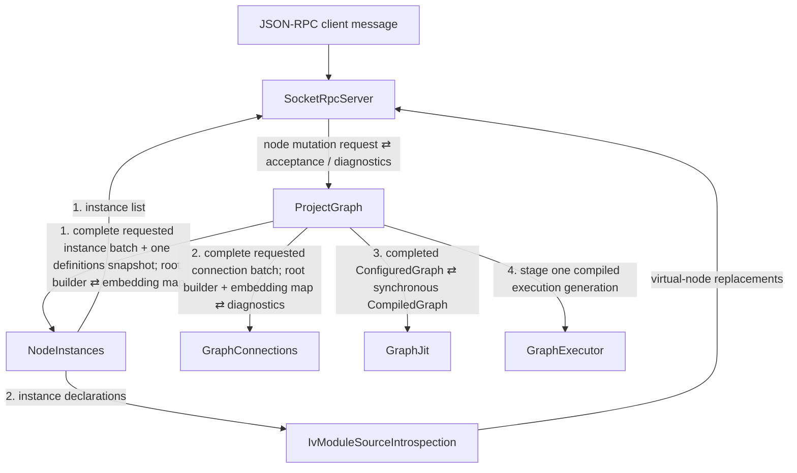
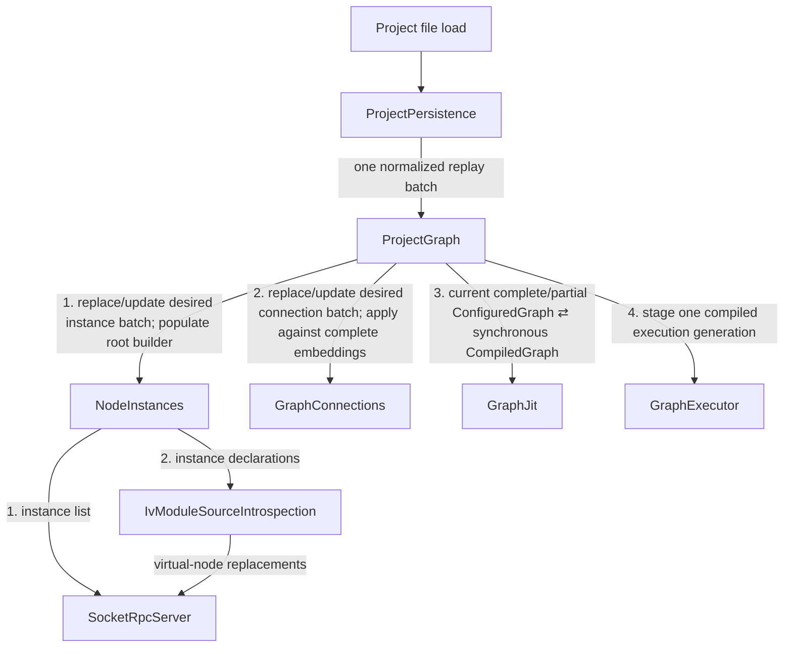

# Event Flows Before Root-Batched Publication (2026-11-12)

_Status: historical, non-normative. Records the app-module propagation implemented
at revision `4ba720f9`. Each diagram keeps the edge labels that
`docs/event_flows/` had at that revision and adds the notification edges that
the implementation raised but the documented trees did not show. Superseded on
2026-11-12 (revision `a3bba875`) by batching presentation notifications at the
cause's root; see
[Event Flows](../event_flows/README.md#presentation-notifications-are-batched-at-the-causes-root)._

## Why this propagation was superseded

Modules notified `SocketRpcServer` partway through a cause, each for its own
read-model change. In one package refresh `SocketRpcServer` was entered once per
notifying module, which the tree constraint in
[Event Propagation Tree Constraint](../event_propagation_tree_constraint.md)
forbids. The checker reported it in two steps. First, `PackageWatcher` raised
both build statuses inside the refresh:

```text
event propagation re-entered module iv::SocketRpcServer
root event: iv_runtime_package_watcher_refresh_requested_event (package_watcher_service.cpp:134)
first path:
    module iv::PackageWatcher
    event iv_runtime_project_notification_event (package_watcher.cpp:400)
    module iv::SocketRpcServer
second path:
    module iv::PackageWatcher
    event iv_runtime_project_notification_event (package_watcher.cpp:400)
    module iv::SocketRpcServer
```

After the build statuses moved to `PackageWatcherService` as separate causes, the
next pair was:

```text
event propagation re-entered module iv::SocketRpcServer
root event: iv_runtime_package_watcher_refresh_requested_event (package_watcher_service.cpp:186)
first path:
    ... module iv::NodeDefinitions
    event iv_runtime_node_definitions_snapshot_changed_event (node_definitions.cpp:292)
    module iv::ProjectGraph
    event iv_runtime_project_graph_node_instances_requested_event (project_graph.cpp:574)
    module iv::NodeInstances
    event iv_runtime_iv_module_instances_list_changed_event (node_instances.cpp:384)
    module iv::SocketRpcServer
second path:
    ... module iv::NodeDefinitions
    event iv_runtime_iv_package_definitions_changed_event (node_definitions.cpp:298)
    module iv::IvModuleSourceIntrospection
    event iv_runtime_iv_module_source_introspection_nodes_updated_event (iv_module_source_introspection.cpp:391)
    module iv::SocketRpcServer
```

User node mutation and project replay had the same shape. They raise their first
event with `IV_INVOKE_LINKER_EVENT`, not `IV_INVOKE_LINKER_EVENT_SOURCE`, so the
checker did not observe those entries.

Edges that exist both before and after and that the documented trees omit
(`NodeInstances -> PackageWatcher` required definitions and
`ProjectGraph -> ProjectAutosave` project state) are omitted here too.

## Notification edges

| Edge | Event | Raised in | Handled by |
| --- | --- | --- | --- |
| `PackageWatcher -> SocketRpcServer` | `iv_runtime_project_notification_event` | `PackageWatcher::emit_status` | `SocketRpcServer::handle_project_notification` |
| `NodeDefinitions -> IvModuleSourceIntrospection` | `iv_runtime_iv_package_definitions_changed_event` | `NodeDefinitions::handle_package_definitions_publication` | `IvModuleSourceIntrospection::handle_iv_package_definitions_changed` |
| `NodeInstances -> SocketRpcServer` | `iv_runtime_iv_module_instances_list_changed_event` | `NodeInstances::publish_instance_changes` | `SocketRpcServer::handle_iv_module_instances_list_changed` |
| `NodeInstances -> IvModuleSourceIntrospection` | `iv_runtime_iv_module_instance_declarations_changed_event` | `NodeInstances::publish_instance_declarations_changed` | `IvModuleSourceIntrospection::handle_iv_module_instance_declarations_changed` |
| `IvModuleSourceIntrospection -> SocketRpcServer` | `iv_runtime_iv_module_source_introspection_nodes_updated_event` | `handle_iv_package_definitions_changed`, `handle_iv_module_instance_declarations_changed` | `SocketRpcServer::handle_iv_module_source_introspection_nodes_updated` |

`PackageWatcherService` also raised `iv_runtime_iv_package_catalog_changed_event`
as a separate source after each refresh, handled by
`SocketRpcServer::handle_iv_package_catalog_changed`.

## Package refresh

Replaced by [Package Refresh](../event_flows/package_refresh.md). The documented
tree had only the `PackageJit` and `PackageDefinitions` children of
`PackageWatcher` and only the `ProjectGraph` child of `NodeDefinitions`.



## User node mutation

Replaced by [User Node Mutation](../event_flows/user_node_mutation.md).
`SocketRpcServer` deferred notifications raised on its request thread until
after the response, so the wire order matched the replacement; the cause still
entered its own root twice.



## User connection mutation

Replaced by [User Connection Mutation](../event_flows/user_connection_mutation.md).
A connection-only mutation raised no notification edge. The tree differed from
the replacement only in the request edge label,
`connection mutation request ⇄ acceptance / diagnostics`.

## Project file replay

Replaced by
[Startup And Project Replay](../event_flows/startup_and_project_replay.md).
Replay runs before any client attaches, so both notifications reached a server
with no clients.


